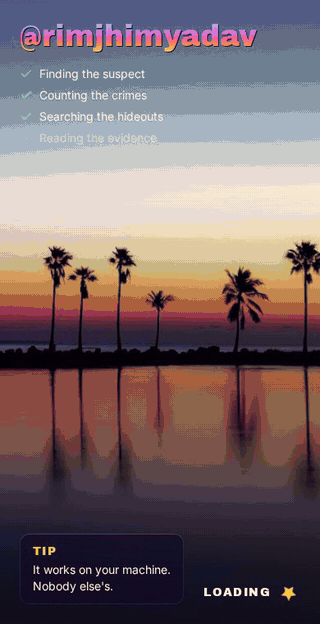

# Git Wanted

Your year on GitHub as a GTA-inspired crime story. Type any username and get a wanted level, a weapon of choice, a criminal record and a Most Wanted poster you can download.

**Live:** https://rimjhimyadav.github.io/gitwanted/

<p align="center">
  
</p>

## Features

- **Story mode**: 6 animated slides like Instagram stories. Tap or use the arrow keys to move, hold to pause
  - **Mission Passed**: your total contributions as a money counter
  - **Wanted level**: 1 to 5 stars from your longest streak, plus the whole year as 12 small calendars
  - **Weapon wheel**: spins through your languages and lands on your top one
  - **Criminal record**: an alias (Night Owl, Early Bird, Weekend Warrior...), peak coding hours and your favorite commit word
  - **Most Wanted poster**: download it as a PNG and share it
- **Profile feed**: everything on one page, as posts on a social app, with comments made from your stats
- **Trophies** that pop up during the story, like console achievements
- Fun error screens: **WASTED** when a user doesn't exist, **BUSTED** with a countdown when the GitHub rate limit is hit

## Built with

- React 19 + TypeScript + Vite
- React Router
- Tailwind CSS v4
- Motion for animations
- html-to-image for the poster
- Vitest for tests
- GitHub Actions to lint, test, build and deploy to GitHub Pages

## Run it locally

```bash
npm install
npm run dev
```

No API key needed.

- `npm test` runs the tests for the stats logic
- `npm run lint` runs ESLint
- `npm run build` type-checks and builds

## Project structure

```
src/
  types.ts      data types (Wrapped, Repo, Day...)
  api/          GitHub requests and caching
  lib/          plain logic: stats, feed, formatting (no React, easy to test)
  hooks/        useWrapped (loads data)
  components/   shared UI: StoryPlayer, Poster, YearCalendar...
  slides/       the 6 story slides
  posts/        the 4 feed posts
  pages/        Home, Story, Profile
```

## Credits

Fan-made parody inspired by the style of GTA games. Not affiliated with or endorsed by Rockstar Games or GitHub. No game assets are used.

Photos from Unsplash by [Tuan Nguyen](https://unsplash.com/photos/kHP6Lfd8e_0), [Andre Tan](https://unsplash.com/photos/UVzDdeAMhkA), [Beres Ioan](https://unsplash.com/photos/0E8zq_98bi8), [Sunira Moses](https://unsplash.com/photos/M99uIpg7PGM), [Tom Morbey](https://unsplash.com/photos/BsbOshnkbpY), [Andy Ramos](https://unsplash.com/photos/H4aul-MzReo) and [Rolando Yera](https://unsplash.com/photos/ATwi-EmGbSE).

Daily contribution data from [github-contributions-api](https://github.com/grubersjoe/github-contributions-api) by grubersjoe.
